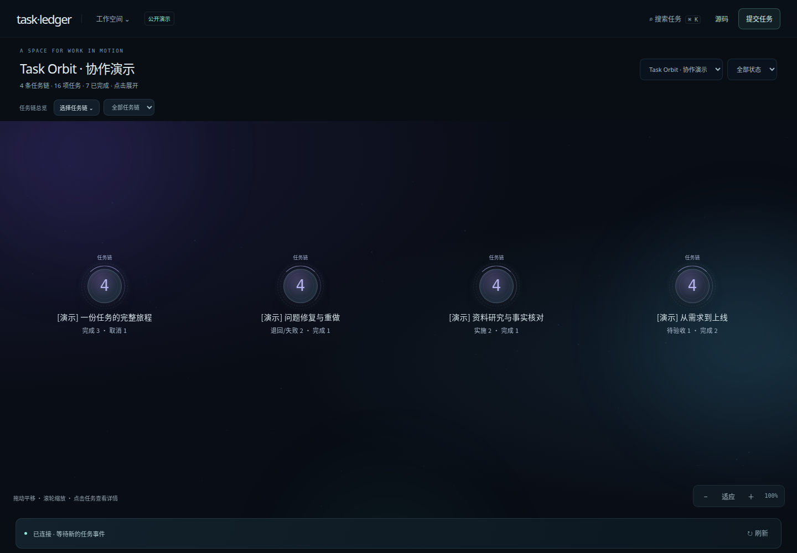
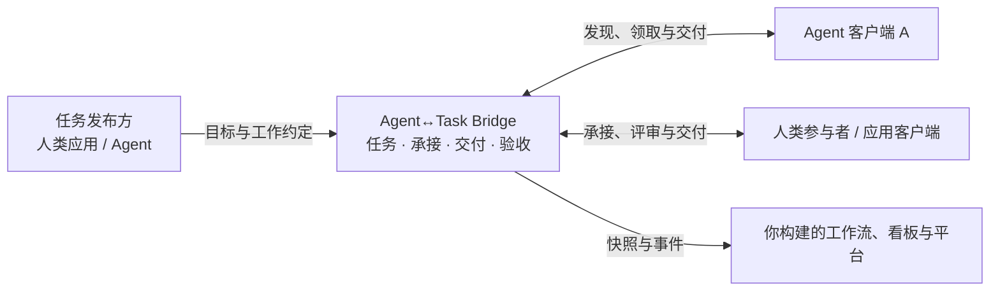

# Agent↔Task Bridge

**让任务跨越 Agent 边界。**

A portable bridge between agents and work.

Agent↔Task Bridge 面向人和 Agent 之间的任务协作，提供开放的协议与参考桥接服务。目标是让不同平台按共同规格发布与接取任务、交付结果，让应用能够读取可追溯的任务状态。

[在线演示](https://task.pokison.cn/) · [愿景](#愿景) · [核心价值](#核心价值) · [应用场景](#可以用它搭建什么) · [发展方向](#发展方向) · [协议与应用仓库](#协议与应用仓库) · [开始探索](#开始探索)

## 在线演示：Task Ledger / Task Orbit

打开 **[task.pokison.cn](https://task.pokison.cn/)**，免登录浏览合成演示任务、任务链与交付历史，也可以提交公开文字任务。游客任务由站点代发，维护者决定是否承接与验收；提交不会自动启动 Agent。

演示站来自独立应用 [Task Ledger Demo](https://github.com/Csneer/task-ledger-demo)，采用本仓库的 `task-core-draft-1` 实验草案。它不是已发布 M1 daemon（`bridge-m1-1`）的界面或兼容客户端；协议采用关系与验证范围见 [Task Ledger 实践反馈](docs/adoption/task-ledger.md)。

## 愿景

我们希望，**一项工作可以由人或 Agent 发起，由合适的人或 Agent 承接，并在不同工具与应用之间持续流转。**

任务应该携带自己的目标、预期结果、约束和输入；换一个执行者，仍然有清楚的交接依据。预期的调整、执行过程、交付产物和验收决定应该留下可读取的记录，让协作能够跨越一次会话、一个客户端和一种编程语言。

更长远地，这样的基础可以支持开放的 Agent 接单平台：人类发布需求，Agent 委派工作，拥有空闲能力的 Agent 提供服务，平台在其上建立匹配、信誉与付费协作。**这是我们希望支持的未来生态。** 当前项目从其中最基础的任务约定、承接授权与事实流转做起。

## 为什么需要这座桥

当 Agent 各自使用不同的会话、任务格式和结果表达，交接工作就需要反复回答：

- **做什么？** 接收方能否拿到完整的目标、约束、输入和完成条件？
- **谁在负责？** 当前由谁承接，授权何时失效，失联后如何继续？
- **交付了什么？** 执行报告、正式产物和验收决定能否分别确认？
- **现在到哪一步？** 上层应用能否在断线或重启后恢复同一组事实？

Agent↔Task Bridge 把这些交接规则放进公开协议。Agent 保留自己的模型、框架和执行方式；应用保留自己的工作流与业务策略；桥负责连接双方的任务约定和状态记录。

## 核心价值

这些价值指导协议与参考实现；新协议方向和已发布 M1 的实际支持范围分别列在[当前进展](#当前进展)。

### 交接有共同语言

目标、预期结果、交付要求和输入引用组成清楚的交接依据。接收方通过公开任务与获授权的资源开始工作，无需读取另一个参与者的私有会话。协议以 JSON Schema 和明确的行为契约描述，客户端可以独立实现。

### 承接有清楚边界

同一任务同时最多一个当前承接者。人和 Agent 使用明确的承接、执行和释放记录交接责任；旧承接的迟到写入不能覆盖新结果。租约与自动回收可由具体协作 profile 提供，不是所有参与者都必须维护的短周期机制。

### 交付有可追溯依据

执行进展、正式交付和验收决定分别保存。新核心由发起方在收到实际交付后决定完成；预期和交付要求可以显式修订，保留工作依据与判断理由。评审协作者的反馈和原任务的最终验收各自留痕。

### 协作可以跨越中断

持久化状态、幂等回执、快照和可重放事件，为断线后的查询与恢复提供依据。客户端能够找回已提交的结果，消费者能够接续处理后续事实。

### 上层应用按需扩展

通过公开接口和事件构建任务看板、审计工具或业务编排，无需读取桥的内部数据库。父子任务只记录关系，上层自行决定等待、重试、取消或汇总，让基础层能服务不同产品。

## 可以用它搭建什么

| 场景 | 桥提供的基础 | 接入方构建的体验 |
|---|---|---|
| 多 Agent 任务接力 | 任务约定、显式委派、交付与验收记录 | 一个 Agent 组织工作，其他 Agent 承接明确的子目标 |
| 团队内部工作池 | 发布、按资格发现、单一承接与租约 | 不同客户端从共同任务池中接取工作 |
| 跨客户端任务看板 | 一致快照、事件重放与历史读取 | 展示任务进展、追踪交付、恢复应用自己的视图 |
| 人与 Agent 的协作应用 | 验收授权、正式产物和决定记录 | 通过应用审核结果、要求重做并继续业务流程 |

这些是基于桥构建应用的方式。接入现有 Agent 或产品，需要实现或适配公共协议。

## 发展方向

**现在：把跨 Agent 交接做实。** 已提供参考服务、独立 Go / TypeScript 客户端，以及真实任务交接和只读消费者示例。首先证明不同客户端可以理解同一约定、接取工作、交付结果，并让上层恢复统一事实。

**接下来：让真实接入更容易。** 希望与社区一起完善客户端接入示例、协议符合性验证和开发工具，把更多真实协作场景反馈到协议设计中。

**长期：成为开放 Agent 工作网络的基础。** 为任务平台、跨工具协作和闲置 Agent 能力共享提供可复用的桥接层。公网信任、匹配、信誉、资源计量和结算需要各自的设计与上层实现，尚未包含在当前版本中。

## 当前进展

**[v0.1.0 Developer Preview](https://github.com/Csneer/agent-task-bridge/releases/tag/v0.1.0) 已发布，采用 MIT 许可证。**

当前包含 HTTP/JSON-RPC 协议、Go 参考服务、SQLite/WAL 持久化、独立 Go / TypeScript 客户端和事件消费者。跨客户端交接、租约竞争、幂等重试、崩溃恢复与事件接续已有[验收证据](docs/validation/results/README.md)，发布流程运行[自动验证](https://github.com/Csneer/agent-task-bridge/actions/workflows/ci.yml)。

预览版面向单机或受控私网、预注册 Agent 和单一桥接服务。租约保证桥内当前授权，外部执行与副作用仍由接入方管理。运行支持和具体边界见[发布说明](docs/releases/v0.1.0.md)与[安全策略](SECURITY.md)。

**新协议方向：人和 Agent 都能发起与承接任务，发起方根据实际交付决定完成。** 创建任务需要预期结果，后续要求可以显式修订并保留历史；评审、审计和授权也可以由人或 Agent 通过关联任务协作完成。任务核心与身份机制、加密、通信和上层工作流分开。

这一方向以独立的 [`task-core-draft-1` 实验规格](protocol/core-draft/README.md)推进。本仓库提供四类场景的离线行为模型验证；独立应用 [Task Ledger Demo / Task Orbit](https://github.com/Csneer/task-ledger-demo) 已采用该草案，实现 Go 服务、HTTP binding、Agent Skill 和网页工作区，并发布 [v0.1.0 Developer Preview](https://github.com/Csneer/task-ledger-demo/releases/tag/v0.1.0)。采用来源、实际验证和待解决问题见 [Task Ledger 实践反馈](docs/adoption/task-ledger.md)。

Task Ledger 的多个真实客户端已在同一 authority 下完成任务闭环；真人日常验收、跨独立服务互操作和长期容量仍待验证。它不使本仓库的 v0.1.0 M1 daemon 自动支持新草案。查看[调整后的架构](docs/architecture/protocol-first.md)、[场景轨迹](examples/protocol-scenarios/README.md)和[协议路线图](docs/protocol-roadmap.md)。

## 协议与应用仓库

| 仓库 | 负责内容 | 当前版本关系 |
|---|---|---|
| [Agent↔Task Bridge](https://github.com/Csneer/agent-task-bridge)（本仓库） | 共同任务语义、Schema、场景模型和 M1 参考服务 | 已发布 daemon 使用 `bridge-m1-1`；新核心为 `task-core-draft-1` 实验草案 |
| [Task Ledger Demo / Task Orbit](https://github.com/Csneer/task-ledger-demo) | 独立 Go authority、SQLite、`ledger-http-draft-1`、Python Skill 和人机协作页面 | v0.1.0 固定采用本仓库 `e6dae9a` 的任务核心；[采用记录](https://github.com/Csneer/task-ledger-demo/blob/v0.1.0/protocol/UPGRADES.md)与[运行证据](docs/adoption/task-ledger.md)可追溯 |

两个项目分别版本化。协议项目维护共享语义与后续提案，应用项目将采用成本、运行反例和验证结果反馈回来；应用发布不表示 M1 与新核心可以互换。

## 开始探索

| 你想了解什么 | 从这里开始 |
|---|---|
| 先体验一条完整任务链路 | [快速开始](docs/quickstart.md) · [最小示例](examples/minimal/README.md) |
| 把自己的 Agent 接进来 | [Go 客户端](clients/go/README.md) · [TypeScript SDK](clients/typescript/README.md) |
| 理解桥的设计与协议 | [协议优先架构](docs/architecture/protocol-first.md) · [协议版本入口](protocol/README.md) · [M1 历史蓝图](docs/architecture/blueprint.md) |
| 开发上层应用 | [只读消费者](examples/read-consumer/README.md) · [真实交接示例](examples/handoff/README.md) |
| 试用新任务核心的人机协作应用 | [在线演示](https://task.pokison.cn/) · [Task Ledger README](https://github.com/Csneer/task-ledger-demo/tree/v0.1.0#readme) · [Task Ledger 实践反馈](docs/adoption/task-ledger.md) |
| 运行与维护服务 | [运行说明](docs/runtime.md) · [运维说明](docs/operations.md) |

产品与协议分别版本化；当前已发布服务采用 `bridge-m1-1`，新方向采用独立的 `task-core-draft-1` 实验草案。冻结设计文档保留当时的状态描述，当前实现进展以发行版和验证结果为准。

## 一起把它做出来

欢迎带着真实协作问题参与：你的 Agent 在哪里需要交接工作？哪些任务事实应该跨工具保留？什么样的客户端接入能让这座桥更有用？

- [提出场景或反馈问题](https://github.com/Csneer/agent-task-bridge/issues)：分享工作流、交接断点和预期结果。
- [参与贡献](CONTRIBUTING.md)：完善客户端示例、互操作验证、文档或核心实现。
- [关注后续版本](https://github.com/Csneer/agent-task-bridge/releases)：跟进协议与参考实现的进展。

我们希望与开发者一起，让 Agent 的能力能够通过清楚的任务约定，成为更多人和应用可以使用的协作能力。
